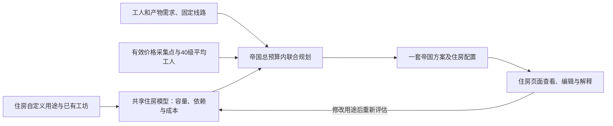

**帝国优化与住房规划协同：保留自定义用途和现有工坊**

方案日期：2026-10-12。基线：`main` / `af00bbcc5b4f498a2e48a2edaf0d40edec1a4556`。状态：已实施。下文保留批准的设计要求；实现说明见 `src/housing/README.md` 与 `src/optimizer/README.md`。

**1. 目标与推荐默认行为**

用户确认的定位：住房规划为帝国优化器服务，提供可供总预算优化使用的房屋容量、依赖及成本组合，同时保留住房自定义用途。住房页面承担需求查看、自定义用途编辑和最终住房方案解释，不再维护另一套与帝国方案并列生效的住房分配。

共同模型读取自动保留的工坊用途与玩家自定义用途，在剩余房屋中比较住宿、仓储和前置依赖组合。帝国优化器根据工人和产物需求，联合选择采集、连接与住房；住房能力既提供低成本组合，也提供增加床位或仓储后的容量/成本选择，供帝国收益目标比较。不能仅固定一份局部最低成本住房结果，再把它当作唯一可用配置。

在保留现有工坊工人、任务、配方、房屋用途、生产设置和必需连接的条件下，重新规划采集任务、40 级平均属性采集工人、连接节点和共享住房/仓库。继续使用前端 Worker + HiGHS WASM。

推荐保留所有空闲工人，不自动删除它们或把它们改派到采集点。新方案中的采集工人仍是平均属性建设建议，不自动使用现有空闲工人的实际技能和属性。保留的工坊工人继续使用原有记录计算固定工坊收益；它们不参与选人或技能优化。

第一轮直接应用覆盖工坊、采集及空闲工人的组合。围栏、自定义任务、实际启用的贸易运输和皇室工坊等额外任务需要独立固定成本/路径模型，本轮不开放其混合一键应用，也不在导出时自动删除或关闭这些配置。历史空配置与实际活动任务应区别检查。生产配方选择、工坊选址、原料供给量与产销联合优化属于后续阶段。

**1a. 一套住房状态与自定义用途优先级**

- 自定义用途单独持久化为玩家输入：指定住宅、住宿、仓库或其他用途的房屋必须按指定用途租用，并计入总贡献点。
- 正在使用的工坊用途同样进入必要约束。与手动用途冲突时指出具体房屋，由玩家调整任务或用途；不擅自覆盖其中一项。
- 其他未指定用途的房屋允许优化器安排。前置房屋只有在用户未指定用途时才参与自动用途选择。
- 已应用的帝国方案中的住房配置是首页和住房页面共同展示的最终配置；尚未应用的新结果作为统一预览，两页引用同一结果版本。
- 保存用途设置与保存结果分开表达。保存自定义用途会使不再满足约束的旧帝国方案失效，并引导重新优化；不把一次单城镇试算作为另一套有效配置叠加到当前帝国。
- 默认需求来自待预览/已应用帝国；没有有效帝国结果时读取当前工人及仓储需求。保留手填床位和仓储的局部试算作为高级预览，明确它尚未用于当前帝国。
- 统一显示总需求、基础/付费容量、房屋需要提供的容量，以及每栋房屋用途和成本。两页使用同一需求口径，避免把免费容量与购房容量混为同一个数。
- 旧 `housingPlans` 保留为历史或局部试算记录。它们不自动转换成用途锁定、不额外计费，也不覆盖已应用帝国住房。用户可以从历史方案选择具体用途作为新的自定义输入。

**2. 当前代码与数据中需要补齐的部分**

| 当前情况 | 需要调整 |
|---|---|
| 工坊房屋及前置依赖已进入住房约束 | 加入固定工人床位、工坊路线和工坊材料/成品仓储 |
| `values.mjs` 的工人容量只约束新采集分配 | 约束保留工人和新采集工人的合计 |
| `townsInfrastructure` 当前用工作中的工人数计算床位 | 增加统一的雇佣工人数口径，空闲工人也占用床位 |
| `townsStoreItemkeys` 当前仅统计采集物品 | 合并工坊材料、成品、人工补充物品及额外预留 |
| `apply()` 整体替换 `userWorkers` | 使用保留工坊/空闲对象与新采集对象的合并函数 |
| `appliedRouting` 当前只恢复采集任务 | 恢复工坊任务、路线、地图关联及共享成本分摊 |
| 导出目前替换工人并关闭部分其他设置 | 导出与应用使用同一合并逻辑，不静默清空其他配置 |
| 结构签名未包含工坊生产及新增仓储配置 | 分别补齐结构、估值与数据版本的失效检查 |

本地配方输出及工作量记录各有 2,359 条，输入材料记录只有 581 条。其余 1,778 条配方不仅缺少输入记录，也包含不可堆叠成品。因此不能依靠“有配方就自动按一类物品一格计算”来保证工坊仓储完整。

**3. 冻结现有工坊与工人记录**

开始计算时生成固定部分的快照：

- 每位工坊工人的原始索引、完整内容指纹、所属城镇、房屋、配方、等级、技能与属性。
- 所有要保留的空闲工人及其所属城镇。
- 正在使用的工坊配置、手动保留房屋用途和前置房屋关系。
- 已确认的工坊工作路线、路线节点集合及特殊城镇的必要激活连接。
- 工坊输入/输出仓储需求和数据完整性状态。
- 当前工坊收益，沿用已有工作量、包装技能及手填每周期利润口径。

只有实际有工人执行任务的工坊自动作为固定工坊。工坊配置列表中的备用房屋不自动租用；用户手动保留的房屋仍按照现有住房设置计入。

工人名称、房屋编号或“城镇+房屋”不能作为唯一标识：多个工人可能使用同一工坊且记录相同。本轮建议用快照中的“原索引+内容指纹”定位，应用前验证列表未变化；合并后重新记录索引映射。保留工人的相对顺序、对象、属性、技能和任务不被采集优化改写。无需为了这一功能先给全部旧工人强制增加全局 ID。

内容指纹采用规范化序列化，避免 JSON 键顺序、未设置字段和零值默认项导致误判。成本模型所需状态与估值状态分别检查，界面显示偏好不作为预算变化。

**4. 固定工坊路线与连接预算**

默认保留当前有效路由中每个工坊任务的 `usedPath`。本地工坊使用所属城镇的单节点路径，跨城工坊保存工人居住城镇与工坊城镇之间的现有有效路径。规范化时核对两个端点、路径方向和逐边连通性，不假设所有相邻关系可以直接反向使用。

来源为当前路由中的工坊任务，不锁定整个 `autotakenNodes`，否则旧采集线路也会被无意保留，无法回收采集贡献点。如果当前工坊没有可验证的有效路径，先显示具体任务的问题，不用猜测路径继续应用。

把固定工坊路径及必需激活连接的节点并集记为 `K`：

- 正式模型中每个 `K` 内节点强制选中，原始贡献点按并集计入一次。
- 新采集可以经过这些节点，复用部分不产生第二笔节点成本。
- 图裁剪保留 `K` 的全部节点和必需端点，避免删除工坊支路。
- 初始化可行解时先加入固定路径、固定工人及仓储需求；计算新增线路边际成本可对已选节点做折扣，正式预算仍用原始贡献点。
- 工坊固定路径单独记录，不能混入用户的刷怪节点列表。既有刷怪节点继续沿用保留开关；取消保留时预览明确列出拟移除的刷怪配置，撤销能够恢复。
- 取消某个城镇作为采集候选，不会取消已有工坊或其工人的住房、仓库及线路。Ancado 等涉及必需激活连接的情况单独校验。

保留现有路径会限制全局重新布线的节省空间。第一轮在该保留条件下优化；以后可另增加“保持任务端点、允许重排工坊线路”模式。

**5. 统一床位与住房约束**

每个城镇的床位需求为：保留的工坊工人数 + 保留的空闲工人数 + 新采集工人数。基础床位和付费床位只扣除一次。

已有工人的所属城镇、工坊所在城镇、工坊仓储城镇、采集候选城镇、采集产物仓库和个人仓储城镇都加入基础设施范围，即使它们不在新采集城镇勾选列表中。

首页、住房配置、追加工人成本、优化模型、初始方案及结果复核必须使用同一套计数规则。工作中的工人数仍可用于收益与任务统计，但不再代替总雇佣工人数计算住房。

工坊房屋继续锁定生产用途，前置房屋可安排未被锁定的合法用途。固定需求与新采集需求共同求解住房，不能先扣整笔原住房成本，再把新方案住房重新收费。租用房屋按并集计费；工坊自身成本在首页单列时，只是展示拆分，不额外加入预算。

**6. 工坊仓储：自动识别、人工补充及迁移**

普通工坊的材料和成品仓库按工人所属城镇处理，而不是工坊所在城镇。官方节点说明明确描述了从工人城镇仓库取材、跨城制作、成品入工人城镇仓库的规则，并要求两城连接。[官方节点与工坊说明](https://www.naeu.playblackdesert.com/en-us/Wiki?wikiNo=20)

配方完整且物品可堆叠时，从现有 `craftInputs` 和 `craftOutputs` 提取材料、全部可能成品的物品编号。在每个仓库中对多个工坊、多个工人及采集产物取并集：相同物品不会因为多个任务重复占基础格数。

人工补充采用两种方式：可明确的物品编号加入同一并集；不能明确的额外格数由用户单独预留。已知输出但缺失输入时，显示已识别部分，要求补充未覆盖部分，不能把缺失输入记作零。没有配方的工坊也需要明确仓储处理方式。

`itemInfo.isStack` 可识别不可堆叠成品。对这类产物要求明确预留件数/格数，不能把一件和一百件都算成同一格，也不擅自推导一天生产量。可堆叠物品的额外堆叠需求、未知物品类型和大批量库存同样允许增加预留。第一轮不实现完整的库存消耗和清仓运输模拟。

每个仓库的需求合计为：已知物品所需格数 + 人工额外预留 + 纯个人仓储 + 一个必要空格。必要空格按整个仓库计一次，不按工人或工坊重复添加；工坊单独生产也应计入。扣除基础、付费和价值礼包容量后交给住房模型。

同时集中化仓库实际可用容量上限的规则，界面、首页和模型共同使用。房屋名义容量总和不能代表无限仓储；超过该城镇实际可用上限时明确判不可行，而不是继续租房得到一个实际无法使用的方案。适用地区与数据版本的上限在实施时核对，不能仅凭角色背包格数推断城镇仓库上限。

加入材料/成品需求不需要相应市场价格，只需要物品和占格信息。没有可靠的工坊利润时，新采集仍可优化，工坊及合计收益显示数据不完整提示。

旧 `storagePersonal` 中可能已经包含工坊材料预留。默认不擅自猜测、扣减或加算。首次启用时按城镇展示旧预留、自动识别部分和人工补充部分，让用户确认工坊份额从原个人预留迁出多少；同一个份额只能进入一个统计项。无法确认的仓储需求允许保存输入和查看问题列表，暂不标为可应用方案。用户可明确确认“已由个人预留覆盖”，继续保守预留；不能默认替用户勾选。

这一步也需要在住房配置面板显示已识别物品、不可堆叠件数和人工额外格数，不能只修改优化器内部的计算。

**7. 预算、收益与预览口径**

继续输入整个参与规划部分的总贡献点预算，覆盖保留工坊、工坊连接、全部保留工人的住房、工坊/采集仓储和新采集节点。先计算“只保留固定部分”的最低可行成本，以便解释剩余空间。

完整预算约束是：节点并集贡献点 + 租用房屋并集贡献点不超过预算。不要把当前首页 `totalCP` 当作固定底价，因为其中包括准备被替换的旧采集任务；也不能把工坊住房全部作为常数扣掉，再重复计入住房变量。

示例，仅用于说明：总预算 300 CP，固定部分最低需求 40 CP。新增采集单独需要 22 CP 节点，其中 10 CP 已在工坊线上，实际只新增 12 CP 节点；共同求解住房比固定基线增加 6 CP，则混合方案为 58 CP。共享节省由节点和房屋并集产生。

优化目标仍为新增采集日收益最大化。固定工坊收益不随候选变化，无需作为竞争变量。预览分别显示固定工坊收益、采集方案预计收益和合计收益；工坊沿用原生产计算，新采集使用 40 级平均属性。

当前采集记录可能使用真实等级和技能，直接与新方案比较时标明假设差异。采集与工坊物品编号重合只用于仓储去重，不承诺原料自给，也不自动改写现有手填周期利润或再次扣税。

固定需求超过预算时显示最低需求及差额，不删除工坊来寻找可行解。固定需求可满足但没有新增采集空间时，可以预览“仅保留工坊及空闲工人”；只有用户明确确认移除旧采集任务后才允许应用。缺价造成无候选时保持现有配置，不能借此自动清空采集。

**8. 应用、导出、撤销和路由显示**

增加一个共享的方案合并函数：读取已验证的当前列表，保留工坊和空闲对象及相对顺序，移除旧采集记录，插入新采集建议，并生成工坊路线到合并后工人索引的映射。应用与 JSON 导出都使用它，避免两个流程形成不同帝国。

应用前检查工人、工坊任务、配方、路线、房屋用途、仓储需求及数据版本未发生结构变化。用当前工人对象保留固定部分，而不是用旧快照对象覆盖玩家后来编辑的记录。变更在一次状态更新内完成，备份保存所有实际修改的字段；撤销用替换恢复对象映射，不能用合并留下新方案的残余条目。

`appliedRouting` 同时恢复工坊和采集路线，将工坊补回 `wsJobs`、`mapJobs`、节点使用者和地图连线。总节点成本取路线并集；各任务共享连接分摊用于展示，不能再次计费。工坊路线份额与房屋自身成本分别核算。分摊对零收益、负收益任务使用非负权重，所有使用者均无正收益时按任务数分摊，避免出现负贡献点或除零。

导出保留实际工坊工人、配方、工坊配置、人工仓储信息及原手动房屋用途。工坊工人仍存在时，自动工坊占用继续由任务推导，不再把它们强制转换成手动锁定，也不关闭围栏或清空贸易数据来冒充兼容方案。

存在本轮尚未建模的活动任务时，只开放明确标识的结果说明/预览导出，不生成带“已应用”标记的混合帝国文件。只有支持范围内的完整合并方案，才标为“可导入首页”；避免保留了其他配置，却用只包含工坊/采集的保存路由覆盖它们。

结构或仓储需求变化后旧方案失效，恢复包含全部现有任务的常规路由；市场价格或手填利润变化仅更新收益、提示原预览过期，已经应用的路线可继续保留。新混合方案使用新版结果结构，旧纯采集方案仍按原版本读取，不因新增空设置被迫失效。

**9. 界面调整**

住房页面默认展示帝国方案的住房：按城镇列出自动分配与自定义用途、房屋依赖、容量、总成本，以及住房支持的工人数和仓储量。自定义用途编辑仍保持现有入口；修改后提示帝国方案需要重新评估，提供进入/启动帝国重新优化的操作。单城镇试算放到独立的高级预览区，不使用容易误认为已经应用的第二套住房状态。

优化页在开始计算前显示保留工坊数、工人数、空闲工人数、每城镇床位/仓储需求、固定连接贡献点，以及配方或仓储数据缺失的待处理项。已有工坊自动进入保留模式，不提供未经建模的“忽略工坊但仍保留它们”选项。

结果预览分开展示保留部分与采集变更，包含工坊不变、旧采集移除/新采集新增数量、共享线路和房屋节省、必要房屋用途变化及总预算。按钮改为“保留工坊并应用采集方案”，确认文本说明空闲工人保留、新采集采用平均属性建设建议，以及可能被取消保留的刷怪配置。

工坊配置或工人编辑页面增加配方数据完整性及仓储补充入口。所有新界面、状态、错误和动态指标同时补齐现有五种语言。

**10. 建议代码分工**

| 模块 | 调整职责 |
|---|---|
| `src/housing` 及住房状态管理 | 为帝国模型提供统一房屋约束/容量成本选择；区分自定义输入、当前帝国住房和局部预览 |
| 新增 `src/optimizer/fixedWorkshops.mjs` | 提取并校验固定工人、工坊、当前路径与快照映射 |
| 新增共享仓储需求模块 | 配方物品并集、堆叠性、人工预留与个人仓储归属，供首页和优化器复用 |
| `snapshot.mjs` | 固定部分、结构/估值/数据签名和支持范围检测 |
| `values.mjs` / `model.mjs` | 合并基础设施范围、固定床位、各仓库固定需求及固定连接约束 |
| `seed.mjs` / `result.mjs` | 固定部分初始解、保留线路与任务独立复核、收益和预算拆分 |
| 新增共享应用合并函数 / `stores/optimizer.js` | 合并工人、应用检查、事务备份与完整撤销 |
| `appliedRouting.mjs` / `stores/routing.js` | 保存并恢复工坊路线、地图任务与共享成本展示 |
| `stores/user.js` / 住房与工坊相关组件 | 统一雇佣工人床位、材料/成品仓储、缓存需求和首页计费 |
| `EmpireOptimizerView.vue` / `i18n` | 保留清单、缺失数据处理、前后对照、导出和五种语言 |

复用当前住房变量与 HiGHS WASM，不引入 Python 或另一个求解器，也不直接替换当前游戏数据包。

**11. 实施顺序与验收**

先统一住房能力、自定义输入和最终方案的展示来源，再按固定快照与需求共享、模型与独立复核、应用/导出/撤销、界面及兼容性四个步骤完成本轮。前两个模型步骤完成前不放开混合一键应用。

验收至少覆盖：

1. 同城工坊无额外连接成本、跨城工坊保持现有有效路线。
2. 多个工坊、多个同房工人共用节点和房屋只计费一次，每个工人保留一次。
3. 工坊城镇、工人城镇不同，以及保留城镇不在采集勾选范围。
4. 固定工坊人数与空闲人数均占床位；基础及付费容量只扣一次。
5. 配方完整、缺失输入、无配方、不可堆叠成品和人工补充各自正确处理。
6. 同物品跨工坊及采集去重、多个仓库独立统计、个人预留归属不重复、超过可用容量上限时正确拒绝。
7. 小图独立穷举核对最优采集收益；正式成本与节点/房屋并集一致。
8. 固定预算不足、没有新采集空间、缺价和零/负工坊收益的解释正确。
9. 应用后工坊与空闲工人完整保留，首页贡献点、采集收益和工坊收益与预览同口径。
10. 同名、同属性、同房工人不会被漏掉或合并成一个，导出/再导入保留绑定。
11. 撤销完整恢复原工人列表、配置和旧方案，无映射残留。
12. 计算期间或计算后修改配方/仓储/工人时旧方案无法覆盖当前配置；价格变化保留已应用路线。
13. Ancado、刷怪节点保留开关、零成本路径和旧纯采集方案兼容。
14. 停止保留已验证方案，忽略迟到结果；五种语言、手机布局、全范围 370 个候选及生产构建验证。
15. 首页、帝国优化页和住房页面展示同一最终住房版本；局部试算和历史方案不叠加占用或重复计费。
16. 修改自定义用途后重新优化仍保留指定用途，自动部分可调整；不可行时解释冲突或预算不足，不解除玩家指定用途。

完成标准：玩家已有工坊和空闲工人被完整保留，采集方案能应用、撤销、导出再导入；预览与首页以同一套床位、仓储、连接和贡献点规则核算。

**12. 本次验证记录**

- `npm test`：81 项通过，包含独立小模型、实际游戏预算复算、保留城镇床位、旧方案读取、索引变化、仓储去重与确认失效。
- 修改的住房/优化核心、新组件、页面及测试通过 ESLint 检查；`git diff --check` 通过。
- `npm run build`：生产构建通过，保持静态网站与浏览器 Worker，不增加服务或依赖。
- 构建后的浏览器：混合应用、撤销、导出再导入、自定义用途、局部预览、WASM 重复工坊路径和仓储补充共 13 项检查通过，无页面或控制台错误。导入另一个已应用版本时清除旧预览，空映射完整替换。
- 全部 370 个采集候选、全部工人城镇、现有工坊/闲置工人及自定义用途，在测试价格下得到 101 个新采集工人的可行方案，贡献点 300/300；约 6.95 秒显示方案，模型含 69,053 个变量及 157,251 个约束。该检查验证可行性与停止保留，不声称全局最优或实际价格收益。
- 英文、繁体中文、俄文、韩文、日文共 70 次页面检查通过；390 像素手机宽度无页面横向溢出。

改动尚未提交或推送。正式使用前按页面提示核对现有工坊的材料、成品件数及个人预留归属；工坊生产设置沿用原记录。

**13. 住房混合方式统一（2026-10-13）**

按全城镇试算结论保留混合方案：普通城镇查表，本城镇有自定义用途或工作工坊占用时逐栋求解。首页、单城镇试算与帝国优化共用 `townHousingPolicy`，其他城镇的限制、未派工工坊配置及历史试算不会改变本城镇的方式。结果记录 `housingMethod`，住房页面和帝国详情提供五种语言的方式标识，兼容旧帝国方案。

本轮验证：82 项测试通过，相关文件 ESLint 与生产构建通过。生产页面确认未派工工坊查表、工作工坊触发逐栋计算、添加/解除自定义用途自动切换、五种语言及 390 像素手机布局。混合应用、撤销、导出再导入及全部 370 个采集候选也通过检查，预览贡献点与首页一致。没有增加服务或依赖，改动仍未提交或推送。

**14. 住房设置入口与重置（2026-10-13）**

住房规划入口集中在“帝国优化 → 住房设置”，不再作为主导航独立入口。住房页保留返回链接，移除独立启动或重算帝国的按钮；仍兼容原页面地址。预算、城镇、仓库、候选范围和刷怪设置在页面往返时保留，计算和应用集中在帝国页。

新增“重置当前城镇住房”：清除所选城镇的手动房屋用途、已保存局部试算与计算缓存，取消该城镇的旧请求，局部输入归零并退出预览。保留工坊任务及其自动房屋占用、仓储预留、付费容量和其他城镇设置。复原恢复手动用途及已保存方案，重置范围在按钮附近明确说明。

86 项全仓库测试、相关修改文件 ESLint、生产构建通过。浏览器验证六项入口/重置/复原/参数保留流程、五种语言和手机布局；完整混合应用、撤销、导出再导入及 370 个采集候选回归通过，无页面错误。当前改动尚未提交或推送。
